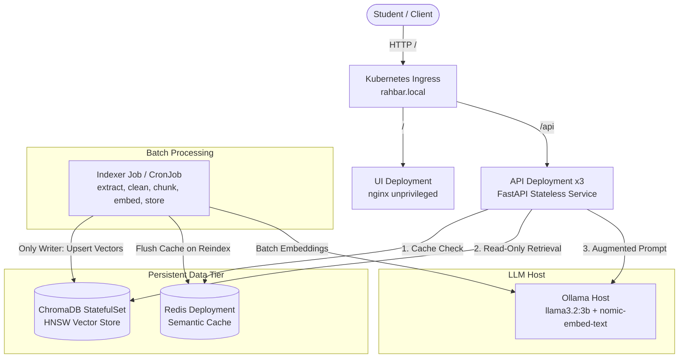

# RAHBAR: Grounded RAG on Kubernetes

[](.github/workflows/ci.yml)
[](k8s/)
[](LICENSE)

**Team Members:**
- **Jehangir Ahmed** (Person A — Data & Quality)
- **Muhammad Abdul Wadood** (Person B — Service & Platform)

RAHBAR is a production-grade, grounded question-answering service deployed on Kubernetes over real institutional regulatory documents from FAST-NUCES. Unlike general-purpose language models that hallucinate policy details or cite repealed rules, RAHBAR retrieves verbatim passages from a ChromaDB vector store, enforces strict metadata filtering (`superseded: false`), generates schema-constrained answers with verified citations, and honestly declines questions outside its corpus. The system adheres to the core architectural invariant: **the indexer Job is the sole writer; the API Deployment only reads**.

---

## Architecture Diagram



---

## API Endpoints Specification

| Method | Endpoint | Purpose | Description |
|---|---|---|---|
| GET | /healthz | Process Liveness | Returns `{"status": "alive"}`. Never touches Chroma, Redis, or the LLM. |
| GET | /readyz | Dependency Readiness | Returns `200` only if Chroma is reachable, collection is non-empty, Redis is reachable, and the indexed embedding model matches `EMBED_MODEL`. Otherwise returns `503`. |
| GET | /metrics | Observability | Exposes Prometheus metrics: request counter, latency histograms, cache hit ratio, and abstention count. |
| POST | /api/ask | Question Answering | Takes `{"question": "..."}` (3 to 500 chars). Returns an `AskResponse` with answer, citations, confidence, and retrieved passages. |

---

## Quickstart: From Clean Clone to Answered Question

### Prerequisites
- Docker & Minikube (or Kind / k3d)
- Python 3.12 & `kubectl`
- Ollama running locally: `OLLAMA_HOST=0.0.0.0 ollama serve`
  - Pull models: `ollama pull llama3.2:3b` and `ollama pull nomic-embed-text`

### 1. Start Cluster with Calico CNI
Start minikube with Calico (required for NetworkPolicy enforcement):
```bash
minikube start --driver=docker --cni=calico --memory=6144 --cpus=4
minikube addons enable metrics-server
minikube addons enable ingress
```

### 2. Create Namespace and Secrets
Secrets are injected from the command line and never committed to version control:
```bash
kubectl create namespace rahbar
export LLM_API_KEY="placeholder-or-key"
kubectl create secret generic rahbar-secret -n rahbar --from-literal=LLM_API_KEY="$LLM_API_KEY"
```

### 3. Fetch Corpus Documents
Download and verify official regulatory documents:
```bash
python corpus/fetch.py
python corpus/fetch.py --verify
```

### 4. Build and Load Docker Images
Build images locally and load them into the cluster:
```bash
docker build -t rahbar-api:dev api
docker build -t rahbar-indexer:dev indexer
docker build -t rahbar-ui:dev ui
minikube image load rahbar-api:dev
minikube image load rahbar-indexer:dev
minikube image load rahbar-ui:dev
```

### 5. Exact Manifest Apply Order
Apply base manifests using Kustomize overlays in strict topological order:
```bash
# Apply dev overlay containing namespace, services, PVCs, StatefulSets, Deployments, and NetworkPolicies
kubectl apply -k k8s/overlays/dev

# Wait for data tier rollout
kubectl rollout status statefulset/chroma -n rahbar --timeout=120s
kubectl rollout status deployment/redis -n rahbar --timeout=120s
```

### 6. Run the Indexer Job
The API pods remain at `0/1 READY` until the collection exists and is populated. Run the indexer:
```bash
# Run one-shot indexer Job
kubectl apply -f k8s/base/indexer-job.yaml

# Wait for indexing completion
kubectl wait --for=condition=complete job/indexer -n rahbar --timeout=300s

# Verify API pods become 1/1 READY
kubectl rollout status deployment/api -n rahbar --timeout=120s
kubectl rollout status deployment/ui -n rahbar --timeout=60s
```

### 7. Triggering On-Demand Re-Indexing
Re-indexing is executed on-demand without redeploying the API:
```bash
kubectl create job --from=cronjob/reindex manual-reindex-1 -n rahbar
```

### 8. Asking Questions
Query through the Ingress or port-forward:
```bash
kubectl port-forward svc/api -n rahbar 8000:8000 &
curl -X POST "http://localhost:8000/api/ask" \
  -H "Content-Type: application/json" \
  -d '{"question": "What CGPA puts an undergraduate student on academic warning?"}'
```

---

## Verification & Golden Evaluation
Run automated evaluation suite against the live cluster:
```bash
python eval/run_eval.py --api http://localhost:8000
python scripts/check_submission.py
```
