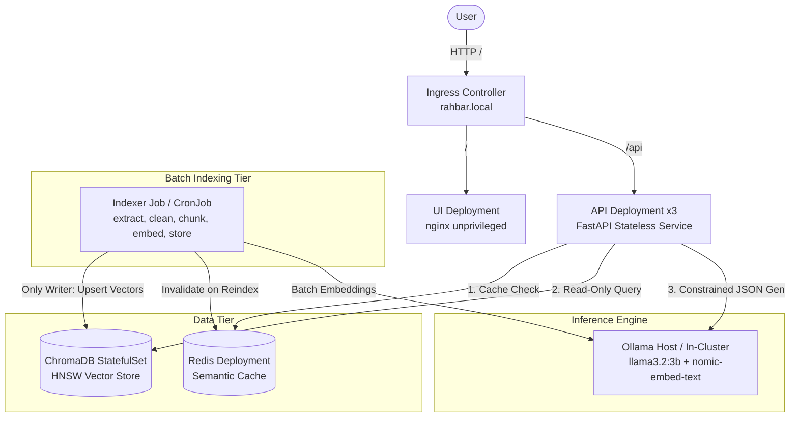

# RAHBAR System Architecture

**Author:** Muhammad Abdul Wadood (Person B — Service & Platform)  
**System:** RAHBAR Grounded RAG on Kubernetes

RAHBAR is a grounded, production-hardened question-answering service deployed on Kubernetes over real university regulatory documents.

---

## 1. Core Architectural Invariant: One Writer, Multiple Readers

1. **Write Isolation:** Only the `indexer` Kubernetes `Job` writes to ChromaDB. It executes one-shot extraction, OCR, cleaning, structure-aware chunking, batch vector embedding, and collection upsertion.
2. **Read Isolation:** The `api` Deployment runs 3 stateless replicas that only issue read queries (`retrieve`) against ChromaDB and check the `redis` semantic cache.
3. **No Indexing on Startup:** The API never indexes documents on startup, completely eliminating multi-pod write contention on Chroma PVCs.

---

## 2. Why Chroma is a StatefulSet (Not a Deployment)

Chroma is deployed as a Kubernetes `StatefulSet` with `volumeClaimTemplates` for three critical reasons:
1. **Persistent Volume Binding:** StatefulSets ensure that each pod is tied to a dedicated PersistentVolumeClaim (`chroma-data`) that survives pod restarts, reschedulings, and node evictions.
2. **Single-Writer Safety:** Vector indexes using SQLite and HNSW memory-mapped files do not support concurrent multi-pod write access. A StatefulSet with `replicas: 1` guarantees strict single-pod ownership of the persistent volume.
3. **Stable Network Identity:** StatefulSets provide deterministic DNS names (`chroma-0.chroma.rahbar.svc.cluster.local`), ensuring predictable connection endpoints.

---

## 3. Semantic Cache and Invalidation

- **Store:** Redis with persistent volume.
- **Threshold:** Cosine similarity threshold $\ge 0.90$ on query embeddings.
- **Never-Cache Safety Policy:** The cache rejects follow-ups, abstentions, out-of-scope queries, and low-confidence responses.
- **Invalidation:** The indexer Job triggers `invalidate_cache()` upon completing index builds, flushing stale cache keys so newly updated policies take effect immediately.

---

## 4. Security Architecture

1. **Non-Root Execution:** All workloads run with `runAsNonRoot: true`, `readOnlyRootFilesystem: true`, and all Linux capabilities dropped (`drop: ["ALL"]`).
2. **Service Account Hardening:** `automountServiceAccountToken: false` on all pods.
3. **Network Isolation:** Default-deny-all `NetworkPolicy`. UI cannot access Chroma or Redis. API can access Chroma, Redis, and Ollama host.
4. **Secret Management:** Secrets are injected exclusively via environment variables from Kubernetes Secrets created out-of-band (`kubectl create secret generic rahbar-secret`).
